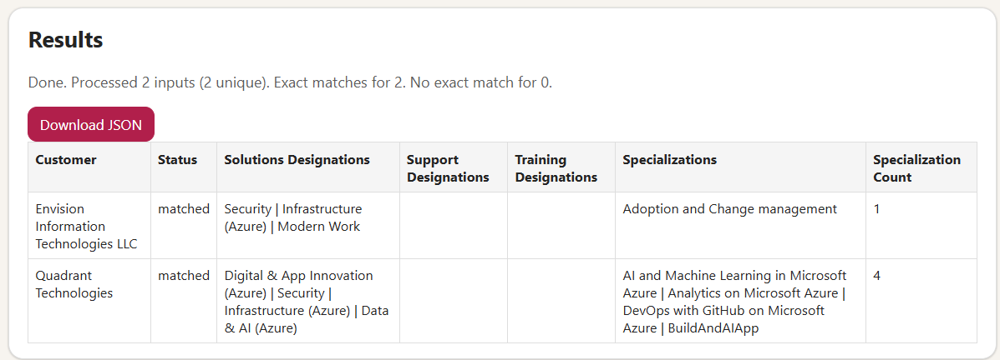

# Partner Designation Lookup App



Web app + API that takes customer names from an Excel/CSV file or JSON payload, queries the Microsoft Marketplace Partner Directory backend, and returns matched partner designation data as JSON or Excel.

## What it does

- Accepts input from:
  - Web UI text list
  - Web UI file upload (`.xlsx`, `.csv`)
  - API (`POST /api/lookup` and `POST /api/lookup/file`)
- Queries:
  - `https://main.prod.marketplacepartnerdirectory.azure.com/api/partners`
- Returns:
  - JSON response with matches per customer
  - Downloadable Excel workbook with `Summary` and `Matches` sheets
  - Designation and specialization details (including specialization count) for the matched prospect

## Quick start

```bash
npm install
npm start
```

Open: `http://localhost:3000`

## API usage

### 1. JSON input

`POST /api/lookup`

```json
{
  "customers": ["Arrow", "Contoso"],
  "designations": ["AzureDataAICompetency", "SecurityCompetency"],
  "includeAllMatches": false
}
```

Optional output query:

- `?output=xlsx` to return an `.xlsx` file instead of JSON.

### 2. File input

`POST /api/lookup/file` as `multipart/form-data`

Fields:

- `file` (required): `.xlsx` or `.csv`
- `columnName` (optional): header name containing customer names
- `designations` (optional): comma-separated codes
- `includeAllMatches` (optional): `true` to include fuzzy/related partner names
- `outputFormat` (optional): set to `xlsx` to return Excel file

## Designation filter codes

Common values:

- `AzureDataAICompetency`
- `AzureInfraCompetency`
- `BizAppsCompetency`
- `ModernCompetency`
- `SecurityCompetency`
- `DigitalAppInnovationCompetency`

## Docker deploy

```bash
docker build -t partner-designation-app .
docker run -p 3000:3000 partner-designation-app
```

Then open `http://localhost:3000`.

## Notes

- This backend appears to be an undocumented/private service and may change without notice.
- Matching is search-based and can return multiple partner candidates per customer name.
- `xlsx` (SheetJS) was removed due unresolved high-severity advisories; this app now uses `read-excel-file` and `write-excel-file`.
- Legacy `.xls` upload is intentionally not supported.
- Default behavior is exact company-name matching only (normalized exact match); set `includeAllMatches=true` if you want broad fuzzy candidates.
